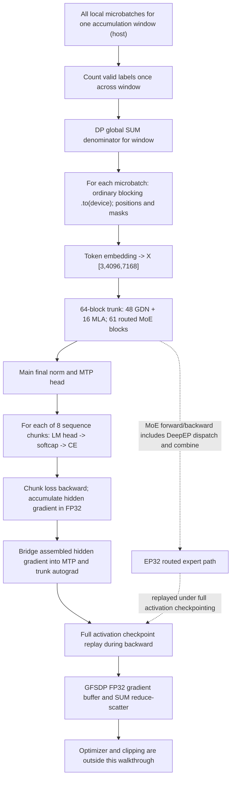
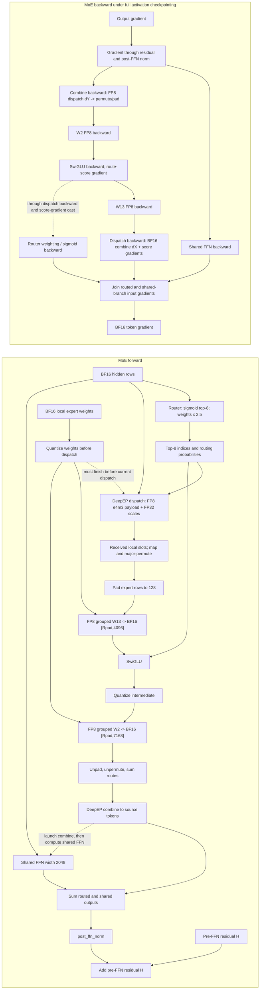
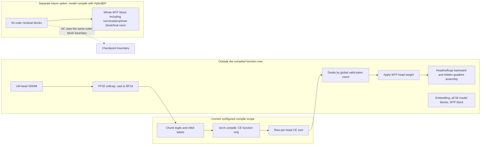

# GIFT 4 700B training flow: GFSDP, EP, FP8, and compile boundaries

**Snapshot and scope.** This walkthrough follows task-copy HEAD `c6eb0f83` (2026-10-27); the task records flattened-source provenance pin `f840cf25e4294f93a5c91a20707c30b97e3c1dbf`, whose upstream Git object is not present in this checkout. The production preset is composed from [`gift_4_700b.yaml`](../gift/configs/experiments/gift_4_700b.yaml), [`gift_700b.yaml`](../gift/configs/presets/train/gift_700b.yaml), and [`gift_4/700b.yaml`](../gift/configs/presets/models/gift_moe/gift_4/700b.yaml).

This describes one local training microbatch from host input through model forward, loss, backward, and GFSDP gradient reduction. It stops before optimizer and clipping. The shipped 700B preset uses the stock `fsdp2` backend, full activation checkpointing, `compile.enable=true` with `components: [loss]` using Inductor, and CPU offload enabled. The analyzed GFSDP adaptation changes only `fsdp_backend=gfsdp2` and `enable_cpu_offload=false`; no recipe file was modified. An executed torch-free pre-submit check passed with those two settings, `compile` still limited to loss, 64 materialized layers (48 GDN and 16 MLA), vocab 128256, hidden size 7168, and MTP chunk count 8. This confirms configuration materialization only; GPU behavior, memory fit, numerical parity, and runtime are unverified.

## 1. Configuration envelope

| Quantity | Value | Consequence |
| --- | ---: | --- |
| Hidden size / sequence / vocabulary | 7168 / 4096 / 128256 | The token activation per local example is `[4096, 7168]`. |
| Local batch / global batch | 3 / 15360 | Each rank has token IDs `[3, 4096]`; hidden state after embedding is `[3, 4096, 7168]`. |
| Dense and batch-group width | `W` | `W` is a multiple of 32; this is the GFSDP and batch grouping used in the analyzed setup. |
| Expert parallel degree | 32 | Expert groups are contiguous 32-rank groups; EP does not divide the batch. |
| Expert FSDP shard width | `W / 32` | The expert-FSDP mesh uses stride 32. Each EP rank owns 8 of 256 experts per MoE layer. |
| Gradient-accumulation count | `5120 / W` | `W` must divide 5120; examples: 160 for `W=32`, 80 for `W=64`. Not every multiple of 32 is valid. |
| Tensor / pipeline / context / replica parallelism | 1 / 1 / 1 / 1 | No TP, PP, CP, or replicated-DP split in this configuration. |
| Parameter storage and GFSDP collectives | FP32 / BF16 all-gather / FP32 SUM reduce-scatter | FP8 activation/projection paths do not make the parameter all-gather FP8. |

The preset and mesh construction are in [`gift_700b.yaml`](../gift/configs/presets/train/gift_700b.yaml), [`parallel_dims.py`](../gift/torchtitan/distributed/parallel_dims.py), and [`parallelize.py`](../gift/torchtitan/models/gift_moe/_base/parallelize.py). The task-specific analyzed adaptation is not saved as a new production recipe.

### Interpreting the batch count

`15360 / 3 = 5120` local-batch units make up the global batch. With `W` batch-group ranks, each accumulation window therefore has `5120 / W` microbatches, and `W` must divide 5120. EP32 is an expert submesh inside the layout; it does not add a second division of the batch. For example, `W=32` gives 160 accumulation microbatches and `W=64` gives 80, while `W=96` does not produce an integer count. This is configuration arithmetic only: it says nothing about whether a particular GPU count or rank placement fits memory.

## 2. One microbatch, end to end

This diagram shows logical dependencies, not a measured timeline. Valid-token counting and the DP denominator are computed once for the accumulation window; model forward/backward then repeats for its local microbatches.

### 2.1 Input preparation

The trainer forms local microbatches on the host, counts valid targets, then obtains the global valid-token denominator with a data-parallel SUM before entering the model loop. The denominator is shared by all microbatches in the gradient-accumulation window. The regular input path uses ordinary `.to(device)` with the default blocking behavior; the standard loop does not pass `non_blocking=True`. Position construction and token masking follow the move. See [`trainer.py`](../gift/torchtitan/trainer.py) and [`loss.py`](../gift/torchtitan/components/loss.py).

### 2.2 Embedding and block order

Token IDs have shape `[3,4096]`; embedding produces BF16 hidden state `X: [3, 4096, 7168]`. The 64-layer trunk is ordered as three GDN+dense-FFN blocks, then one MLA+MoE block, followed by 15 repetitions of three GDN+MoE blocks and one MLA+MoE block. That yields 48 GDN blocks, 16 MLA blocks, and 61 routed MoE blocks. The first three GDN blocks have their own dense FFN of width 18432; each later block has a routed MoE plus a separate shared FFN branch. The block residual path is `x + post_attn_norm(attention(attention_norm(x)))`, then `h + post_ffn_norm(FFN_or_MoE(ffn_norm(h)))`. See [`decoder.py`](../gift/torchtitan/models/common/decoder_blocks/decoder.py), [`transformer_block.py`](../gift/torchtitan/models/common/decoder_blocks/transformer_block.py), and [`gift_moe`](../gift/torchtitan/models/gift_moe/__init__.py).

### 2.3 Gated DeltaNet (GDN) attention

For local input `[3,4096,7168]`, packed QKV projects to 16384 channels. One fused causal-convolution/SiLU/unpack/QK-L2-normalization op produces Q and K `[3,4096,32,128]` and V `[3,4096,64,128]`. `ba_proj` produces 128 channels split into 64 beta and 64 a channels; another projection produces an 8192-wide gate `Z`. GDN has no RoPE.

The chunked gated-delta scan uses chunk length 64 and several specialized kernels for decay/cumulative sums, triangular KKT solve, WY state construction, and output. It is not one fused whole-attention kernel. The fused external gated RMS norm already applies the sigmoid gate from `Z`; its result is multiplied by 2 before the output projection from 8192 to 7168. The implementation and custom-op wrapper are in [`gdn.py`](../gift/torchtitan/models/common/attention/linear/gdn.py), [`qkv.py`](../gift/torchtitan/models/common/attention/qkv.py), and [`fla_custom_ops.py`](../gift/torchtitan/models/common/attention/linear/fla_custom_ops.py).

### 2.4 Multi-head Latent Attention (MLA)

The MLA query path maps 7168 to 1536, applies the configured self-gated query normalization, scales by `sqrt(7168/1536)`, and expands to 64 heads of width 192. The KV path maps 7168 to 576, splitting a 512-wide content latent from a 64-wide positional component; it normalizes/scales the latent by `sqrt(7168/512)` and expands content K and V to 64 heads of width 128. RoPE acts on the 64-wide positional component in complex FP32, then the shared positional K is expanded across heads and concatenated with the 128-wide content K. The attention QK width is therefore 192; V width is 128.

Causal SDPA receives Q `[3,4096,64,192]`, K `[3,4096,64,192]`, and V `[3,4096,64,128]`. The configured backend priority is cuDNN, Flash, then math; the actual selected backend on target hardware has not been measured. Output flattening gives 8192 values, which are multiplied by an FP32 sigmoid gate and cast back to BF16 before `wo` projects to 7168. See [`mla.py`](../gift/torchtitan/models/common/attention/softmax/mla.py), [`gate.py`](../gift/torchtitan/models/common/attention/softmax/gate.py), and [`sdpa.py`](../gift/torchtitan/models/common/attention/softmax/kernels/sdpa.py).

### 2.5 Dense FFN, FP8 selectors, and routed experts

The active FP8 module-name selector matches projection names ending in `.w1`, `.w2`, `.w3`, or `.wo`. In this model that covers dense/shared FFN projections and MLA `wo`; it does not select GDN `qkv`, `ba`, `z`, or `o_proj`, MLA `qkv` or `gate_proj`, the MTP input projection, norms/gates, or the LM head. The dense/shared FFN quantizes its input, runs FP8 `w1`/`w3` GEMMs, applies fused SwiGLU, quantizes again, then runs FP8 `w2`. The routed expert path has its own FP8 selection and dispatch handling. FP8 conversion is downstream of GFSDP's BF16 weight all-gather. See [`fp8_full.yaml`](../gift/configs/presets/train/fp8_full.yaml), [`gmm.py`](../gift/torchtitan/models/common/moe/experts/gmm.py), and [`parallelize.py`](../gift/torchtitan/models/gift_moe/_base/parallelize.py).

For each MoE call, a local `[3,4096]` token set contains 12288 token rows. A 256-expert router uses sigmoid scores, selects top 8, renormalizes them, and multiplies selected weights by 2.5. The load-balance auxiliary coefficient is `1e-4`; router z-loss and projection z-loss are off in the selected GIFT 4 preset. Do not assume the router calculation is guaranteed FP32: the active plain-linear/gather path's exact router dtype is not established here. DeepEP accepts FP32 routing probabilities explicitly. Its dispatch backward casts score gradients back to hidden-state BF16; account for that rounding boundary in any parity comparison. See [`moe/__init__.py`](../gift/torchtitan/models/common/moe/__init__.py), [`regularization.py`](../gift/torchtitan/models/common/regularization.py), and [`deepep.py`](../gift/torchtitan/distributed/deepep/deepep.py).

The received expert rows are assigned by local expert index, major-permuted, and padded to multiples of 128. Per-rank W13 has shape `[8,4096,7168]`; its FP8 grouped GEMM produces BF16 `[Rpad,4096]`. SwiGLU multiplies the two 2048-wide halves and applies selected route probabilities between the two GEMMs; the result is quantized before FP8 W2 `[8,7168,2048]`, producing BF16 `[Rpad,7168]`. Unpadding, inverse permutation, and route summation precede asynchronous BF16 combine. The routed output and width-2048 shared FFN are summed before `post_ffn_norm` and the residual add; the shared branch runs after combine is launched and can overlap that combine, with a stream wait before adding the routed and shared outputs. Expert weights are BF16 before their FP8 quantization, which currently occurs before token dispatch. See [`gmm.py`](../gift/torchtitan/models/common/moe/experts/gmm.py) and [`deepep.py`](../gift/torchtitan/distributed/deepep/deepep.py).

Two host/device details are potential measurement targets, not established bottlenecks. Expert-weight quantization currently happens before dispatch, leaving an unproven opportunity to overlap it. The padded permutation helper calls `tokens_per_expert.cpu().tolist()`, a host synchronization point. DeepEP count handling also materializes CPU counts and transfers metadata; reusing those counts or fusing GPU-side metadata construction is a candidate only after confirming the exact call path and measuring it. See [`padded_permutation.py`](../gift/torchtitan/ops/float8/triton_kernels/padded_permutation.py) and [`deepep.py`](../gift/torchtitan/distributed/deepep/deepep.py).

### 2.6 Final norm, MTP, and vocabulary loss

The main path applies its final norm. The auxiliary MTP head consumes the trunk state before that final norm and a one-token-shifted embedding. It normalizes token embeddings and hidden state, concatenates them to 14336 channels, projects back to 7168, runs an MLA+dense-FFN block, and applies its final norm. The main and auxiliary predictions are combined as two heads over `[3,4096,7168]`; the configured auxiliary loss weight is `[0.1]` (the main loss has unit weight). See [`mtp.py`](../gift/torchtitan/models/common/decoder_blocks/mtp.py), [`decoder.py`](../gift/torchtitan/models/common/decoder_blocks/decoder.py), and the [`700B model preset`](../gift/configs/presets/models/gift_moe/gift_4/700b.yaml).

The loss folds the two heads into batch shape `[6,4096,7168]` and splits sequence into 8 chunks of 512. Each chunk projects through the BF16 LM head to logits `[6,512,128256]`. Softcap 30 is computed in FP32, then rounded back to BF16 before the compiled CE function converts logits to FP32, flattens logits and labels, and sums CE with `ignore_index=-100`. Division by the global valid-token denominator and application of the head weight are outside the compiled function. The loop performs 8 LM-head forwards and 16 per-head CE calls per microbatch; each chunk's CE backward runs immediately, and the hidden gradient is accumulated in FP32. The head's gathered weights are held across chunks; enabled head-reduction coalescing delays its reduce-scatter to the last chunk. A separate GFSDP head-gradient buffer is used. The completed hidden gradient is bridged into MTP/trunk autograd. See [`loss.py`](../gift/torchtitan/components/loss.py), [`mtp.py`](../gift/torchtitan/models/common/decoder_blocks/mtp.py), and [`token_debeddings.py`](../gift/torchtitan/models/common/embeddings/token_debeddings.py).

Memory arithmetic illustrates the chunking boundary, not measured allocation or peak memory. One two-head BF16 chunk contains `6 × 512 × 128256 = 394,002,432` elements, or 751.5 MiB. All two-head logits at full sequence length would be 6012 MiB. One head's FP32 CE input for a single chunk is also 751.5 MiB before compiler fusion or reuse. These values do not include other live tensors, workspace, allocator behavior, or compiler materialization.

## 3. Backward and GFSDP communication

Full activation checkpointing replays the block region on backward, including MoE routing, DeepEP communication, and FP8 activation conversion. GFSDP pre-backward hooks recognize checkpoint replay so they do not trigger an extra ordinary forward all-gather cycle. GDN's custom VJP additionally reruns the native FLA forward in its gradient path before native backward; FLA also recomputes some WY/state intermediates internally. Do not count that as a blanket fixed number of full forward executions: it is an operator-specific replay nested inside block checkpointing. The current setting is full AC; selective AC is an explicit saved alternative and is inactive here. See [`trainer.py`](../gift/torchtitan/trainer.py), [`parallelize.py`](../gift/torchtitan/models/gift_moe/_base/parallelize.py), and [`fla_custom_ops.py`](../gift/torchtitan/models/common/attention/linear/fla_custom_ops.py).

Within an MoE block, combine backward sends the expert output gradient through FP8 dispatch and the expert permutation/padding path. Expert W2 backward computes input and weight gradients, SwiGLU backward propagates activation, gate, and score gradients, and W13 backward computes the first projection gradients. The expert projection weight-gradient path requantizes the row-major BF16 input for its FP8 GEMM. Dispatch backward combines the expert input gradient into BF16 token gradients and returns score gradients, which cross the noted BF16 cast. The shared-branch gradient joins the routed gradient at the block FFN input.

GFSDP copies BF16 full gradients into an FP32 gradient buffer and reduce-scatters with FP32 SUM; there is no extra scaling factor. In this non-PP path, gradient reduce-scatter happens normally per microbatch rather than being deferred to an end-of-accumulation no-sync phase. Dense parameters use the dense GFSDP group; experts use the expert-FSDP group of width `W/32`; the head has its own gradient buffer. There is no extra expert-gradient all-reduce across EP: routed token outputs are combined back at the source owner, while expert parameter gradients reduce-scatter over the expert-FSDP group. The following optimizer and clipping step is outside scope.

GFSDP maintains two reusable BF16 full-parameter buffers per process group under the default reshard policy, plus gradient storage. The automatic policy can retain selected final groups instead of resharding every group. The explicit prefetch chain covers embedding, blocks, final norm, MTP, and head in reverse-backward order, while skipping a prefetch when its target buffer is occupied. All-gather and reduce-scatter share one root-shared high-priority communication stream across groups, so they can overlap compute but not one another on that shared stream. See [`_state.py`](../gift/torchtitan/distributed/gfsdp/_state.py), [`_param_group.py`](../gift/torchtitan/distributed/gfsdp/_param_group.py), and [`_collectives.py`](../gift/torchtitan/distributed/gfsdp/_collectives.py).

## 4. Exact compile boundaries

| Region | Current setup | Optional HybridEP model-compile setup |
| --- | --- | --- |
| CE function | Compiled | Compiled with loss |
| 64 outer residual blocks | Eager | Compiled as model blocks |
| Whole MTP block | Eager | Compiled, including its internal norms, concat, projection, inner block, and final norm |
| Token embedding, main final norm, outer MTP shift/stack/decoder concatenation, LM head | Eager | Remain outside model compile |
| FLA and DeepGEMM custom-op internals | Called from eager code; custom-op internals stay outside compile | Custom-op internals are not fused by model compile |
| DeepEP | Current dispatch path outside CE compile | Not in this model-compile alternative; it requires HybridEP |
| CuTe norm kernels | Not used by the stock preset | Separately enabled option; not fused by model compile |

In the current 700B preset, only the CE function is compiled. Its compiled operations cast logits to FP32, flatten logits and labels, and sum CE. The LM-head projection, softcap and BF16 cast, division by the global valid-token denominator, per-head loss weighting, head-gradient assembly, trunk, and MTP model block are outside that compile region. Custom-op internals are not fused by caller compilation. This future model-compile alternative uses HybridEP; DeepEP is not shown inside its compile region. The exact current loss contract is documented in [`loss.py`](../gift/torchtitan/components/loss.py); config is in [`gift_700b.yaml`](../gift/configs/presets/train/gift_700b.yaml).

An optional future model-compile scope has different constraints: it would wrap the 64 outer residual blocks and the whole MTP block, including its input norms, concatenation, projection, inner block, and final norm. It would not include the token embedding, main final norm, outer MTP shift/stack/decoder concatenation, or LM head. Activation checkpointing uses the same outer-block boundary. This is not the current setup: the model compile path requires HybridEP, while DeepEP rejects that path in this configuration. PyTorch's custom-op/library boundary is documented in its [custom operator guide](https://docs.pytorch.org/docs/stable/library.html) and [kernel-versus-custom-op discussion](https://dev-discuss.pytorch.org/t/user-defined-kernels-vs-torch-library-custom-op/2113). Treat compiler-generated Triton and hand-written kernels as algorithm alternatives whose memory traffic, launch count, and numerical behavior must be measured; compile enablement alone is not a fusion claim.

## 5. SOTA-backed candidates to take into a trace

These are hypotheses derived from code boundaries and pinned external implementations, not expected speedups. Each needs an eligible hardware/software stack, correctness evidence, and a representative trace before implementation claims.

### A. Fuse LM-head projection with softcapped cross entropy

**Why inspect it.** The current CE is chunked, but the LM head still materializes each chunk's logits, then softcaps/casts, then converts to FP32 CE input. A tiled linear-cross-entropy kernel with online log-sum-exp could reduce vocabulary-logit traffic and lifetime. This is the clearest remaining large activation boundary in the path.

**References.** Apple ML Research [CUT Cross Entropy at `3de376c`](https://github.com/apple-aiml-research/ml-cross-entropy/blob/3de376c106a1916bc5e1b619f9c77c87a461ee1c/cut_cross_entropy/linear_cross_entropy.py); LinkedIn [Liger fused linear CE at `781a8ae`](https://github.com/linkedin/Liger-Kernel/blob/781a8aef64bf6105bdefb5f4c991e0d14c08e793/src/liger_kernel/ops/fused_linear_cross_entropy.py) and its [historical chunked-weight-gradient discussion](https://github.com/linkedin/Liger-Kernel/issues/512). These are reference implementations, not evidence of integration with this GFSDP head.

**Boundaries to preserve.** GIFT rounds FP32 softcap output back to BF16 before CE promotes to FP32. External `cce_exact` does not preserve that BF16 rounding automatically; its exactness mode is not bitwise or numerical parity with this formula by default. Fix and record the external kernel's gradient-filter, `cce_exact`, and Kahan settings for any comparison. Preserve softcap 30, ignored int64 target semantics, global-token normalization, main/aux head weighting, FP32 accumulated hidden gradient, head gather lifetime, and GFSDP reduce-scatter/coalescing. The current classifier/head may expose DTensor or full-tensor paths that the external kernel does not support; there is no GFSDP-hook integration proof. Compare eager baseline loss and gradients before timing. If an exact integration is unavailable, the less ambitious Liger path still needs FP32 accumulation and gradient parity checks.

### B. Fuse norm/gate and residual operations at existing eager boundaries

**Why inspect it.** The counted forward has 298 self-gated normalization calls (`64×4 + 1×4 + (16+1)×2 + 3 + 1`), and the current norm/gate operations are eager. Isolated compilation of pure norm/gate or softcap regions is a useful comparison baseline before a manual-kernel rewrite, but it is not an existing granular YAML switch and would need integration. These are small regions around large hidden-state tensors, so an eligible fusion could remove launches and full-hidden reads/writes. The count is derived from the materialized block/MTP structure; it is not a runtime count measurement.

**References.** FLA's pinned [fused norm-gate implementation at `1b74d1e`](https://github.com/fla-org/flash-linear-attention/blob/1b74d1e0a71070d642b47385f86b86cc45d56324/fla/modules/norm/fused_norm_gate.py) consumes an external gate tensor and is not automatically equivalent to GIFT's self-gate MLP. Transformer Engine's [backward-add-RMSNorm at `89668d9`](https://github.com/NVIDIA/TransformerEngine/blob/89668d9dee82aba9b9107b37ed85227542a578d2/transformer_engine/pytorch/ops/fused/backward_add_rmsnorm.py) and [cuDNN-backed fusion proposal](https://github.com/NVIDIA/TransformerEngine/pull/2778) provide a residual-fusion reference; the cited proposal requires cuDNN 9.21 or later.

**Boundaries to preserve.** The current formula has rank-16 self-gating, FP32 normalization/gate math, BF16 boundaries, `zero_centered=false`, and zero-initialized post-attention norm weights for GIFT 4. If separately enabled, existing CuTe normalization kernels are SM90-specific and can alter BF16 rounding; they are off in the stock preset. Start with read/write and launch counts on the target rank; require eager/compiled loss and gradient parity before throughput comparison.

### C. Make MLA SDPA backend choice explicit and verify head-layout support

**Why inspect it.** MLA's `[QK=192,V=128]` shape and shared positional K may use different kernels depending on the installed SDPA backend. The selected cuDNN/Flash/math path is currently unknown, so first capture the actual kernel and backend in a representative trace. If fallback or layout conversion dominates, an explicit FlashAttention-3 path is a candidate.

**Reference.** Dao-AILab [FlashAttention Hopper API at `98c1cee`](https://github.com/Dao-AILab/flash-attention/blob/98c1cee0ed59307833841cdbf567fe336ceec13a/hopper/flash_api.cpp) explicitly supports forward and backward for QK width 192 and V width 128. A [maintainer discussion on an explicit interface and backward layout](https://github.com/Dao-AILab/flash-attention/issues/1109) flags integration requirements; it is not a measured result for GIFT. The installed GIFT package/kernel version and GPU fit remain unverified.

**Boundaries to preserve.** RoPE is applied to the 64-wide positional component; QK concat width 192; V width 128; causal masking; sigmoid output gate and cast-back to BF16 before `wo`; dropout behavior; and backward layout. Test forward and backward parity on the actual attention shapes. GIFT's FA4 selective-checkpointing operator remains a separate TODO and is not an automatic part of this candidate.

### D. Remove redundant MoE metadata synchronization or overlap quantization with dispatch

**Why inspect it.** The padded-permutation helper calls `.cpu().tolist()`, while DeepEP count handling also creates CPU counts and transfers metadata. Trace host launch gaps and H2D/D2H edges to identify whether this path repeats synchronization. Separately, expert-weight quantization precedes dispatch, which may leave a safe overlap window if dependencies and buffer lifetimes permit.

**References.** Transformer Engine's [MoE host-synchronization issue](https://github.com/NVIDIA/TransformerEngine/issues/2438) explicitly discusses avoiding D2H synchronization. NVIDIA Megatron's [token dispatcher at `9dd63d9`](https://github.com/NVIDIA/Megatron-LM/blob/9dd63d992a5925dba7f9bfd1aec9dbfb1f54b837/megatron/core/transformer/moe/token_dispatcher.py) is a dispatcher reference. TE's [grouped MLP implementation at `89668d9`](https://github.com/NVIDIA/TransformerEngine/blob/89668d9dee82aba9b9107b37ed85227542a578d2/transformer_engine/pytorch/ops/fused/grouped_mlp.py) targets newer SM100/MXFP8/NVFP4 paths and is not an SM90 drop-in. NVIDIA's [Megatron Bridge EP overlap guidance](https://docs.nvidia.com/nemo/megatron-bridge/0.6.2/skills/nemo-mbridge-perf-expert-parallel-overlap/SKILL.html) documents control interactions; its batch-EP overlap mode is incompatible with full activation checkpointing. Do not propose disabling full AC to enable it.

**Boundaries to preserve.** Expert capacity/padding, token-to-expert ordering, top-8 weight normalization and scale, FP8 payload/scales, async combine ordering, shared-branch stream wait, BF16 score-gradient cast, and full AC. Verify identical routing and output/gradient behavior, then measure host sync count, metadata bytes, overlap window, and rank imbalance. Reusing host counts is only valid if the dispatch API exposes those exact counts without another copy.

### E. Inspect GDN custom-VJP replay before changing scan internals

**Why inspect it.** The block checkpoint already replays GDN and the custom VJP runs native FLA forward work again for backward. A trace and saved-tensor accounting can identify whether duplicated wrapper work or internal scan recomputation is material before changing any kernel.

**References.** The pinned FLA [`chunk.py` at `1b74d1e`](https://github.com/fla-org/flash-linear-attention/blob/1b74d1e0a71070d642b47385f86b86cc45d56324/fla/ops/gated_delta_rule/chunk.py) exposes the chunk scan state/recompute contract. FLA's [checkpoint nondeterminism report](https://github.com/fla-org/flash-linear-attention/issues/945) and [follow-up fix](https://github.com/fla-org/flash-linear-attention/pull/953) are B300-specific evidence, not evidence of an SM90 bug here.

**Boundaries to preserve.** Do not remove full AC or duplicate/recompute the scan differently until saved state, determinism, dropout/RNG state, native forward/backward contract, and peak memory are understood. Any replay adjustment changes a runtime and memory tradeoff, not just a wrapper call count.

## 6. Bounded trace questions and acceptance gates

The first trace should answer which of these mechanisms is present, not claim a speedup:

1. **Loss/head:** Are LM-head chunks, softcap/cast, CE, or head all-gather/reduce-scatter dominating? Does the backend materialize FP32 logits or fuse their conversion? Capture chunk count and peak live memory.
2. **MoE:** Are `.cpu().tolist()` or DeepEP count transfers visible as device gaps? Are dispatch/combine, expert GEMMs, or expert-weight quantization on the critical path? Record EP rank skew and the shared-FFN overlap interval.
3. **Attention:** Which MLA SDPA kernel is actually selected for QK192/V128? For GDN, separate native FLA scan kernels from wrapper launches and checkpoint/custom-VJP replay.
4. **GFSDP:** Map all-gather, reduce-scatter, compute, and prefetch per group. Confirm buffer reuse, retained groups, shared communication stream serialization, and whether any collective misses its intended overlap window.
5. **Compilation:** Confirm only the CE function is compiled in this setup. Record warm-up/compile separately from steady-state; do not count custom kernels as model-compile fusion.

No GPU trace, throughput result, memory-fit result, or production readiness claim is included in this report. A future candidate comparison needs a representative warmed step, stable repeated unprofiled steps for magnitude, an identical control pair for noise, the resolved config plus activation markers, and eager/reference loss and gradient checks for any changed computation. Preserve full AC and the analyzed GFSDP/EP/FP8 path unless a configuration change is separately agreed and validated.
