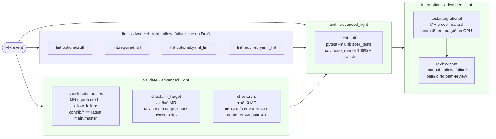
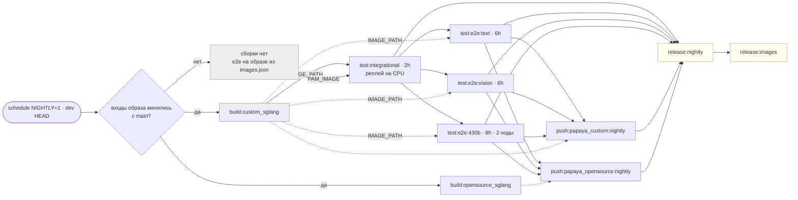
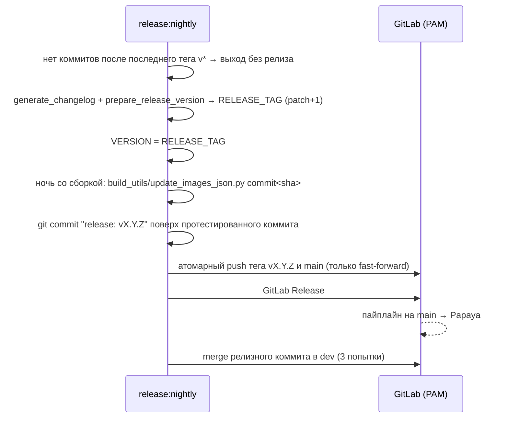
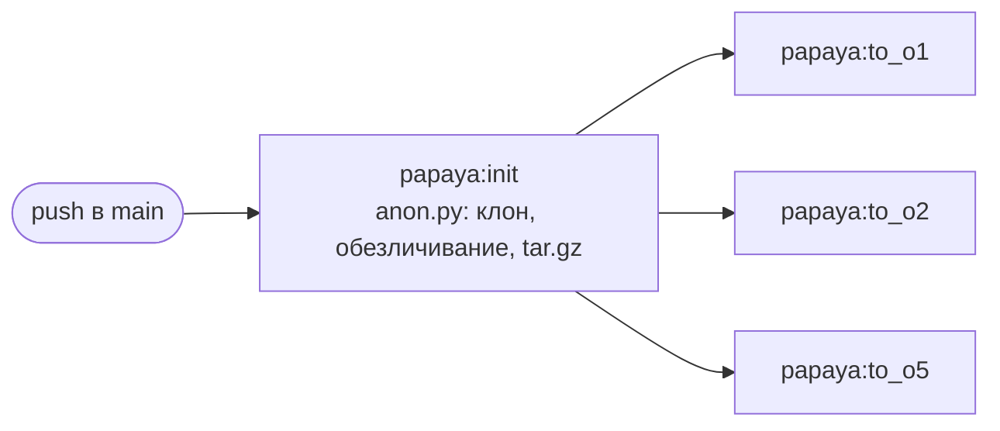
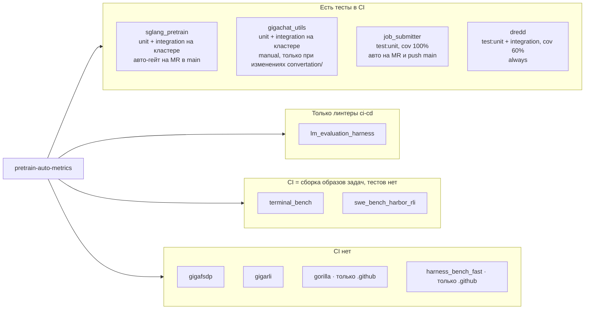

# Карта CI/CD пайплайнов PAM

Снимок на 2026-10-09: `pretrain-auto-metrics/.gitlab-ci.yml` + `gigallms/ci-cd` main.
Шаблоны, раннеры и общие правила приезжают из `ci-cd` через `include`:
`components/build.yml`, `new_gen/release.yml`, `new_gen/papaya.yml`, `components/linters.yml`, `pipelines/check_submodules.yml`.

Стейджи (задаёт `ci-cd/base/templates.yml`): `lint → validate → build → test → unit → integration → deploy → release`.
PAM использует `lint`, `validate`, `build`, `unit`, `integration`, `deploy`, `release`. `needs` может ссылаться только на джобы своего или более раннего стейджа.

## 0. Ветки и когда вообще создаётся пайплайн

| Ветка / тег | Роль | Кто пишет |
|---|---|---|
| `dev` | интеграционная ветка, цель всех MR | merge: Developers + Maintainers; push: Maintainers (релиз-бот) |
| `main` | последний релиз, ветка по умолчанию | только релиз-бот (fast-forward) и hotfix-MR мейнтейнеров |
| `vX.Y.Z` | релизный тег, protected `v*` | релиз-бот; minor/major — руками мейнтейнер |

`workflow: rules` создаёт пайплайн только на:

| Источник | Пайплайн |
|---|---|
| `merge_request_event` | [MR](#1-пайплайн-на-mr) |
| `schedule` (`NIGHTLY=1`) | [ночной](#2-ночной-пайплайн-на-dev) |
| `push` в `main` | [выкладка кода на Papaya](#3-пайплайн-на-push-в-main) |
| `web` (Run pipeline) | [ручные кнопки](#4-ручной-пайплайн-run-pipeline) |
| `push` в ветку, кроме `main` и `dev` | кнопки `build:*`/`push:papaya_*` и `trigger:papaya`: дочерний пайплайн `ci-cd/pipelines/papaya.yml` с ручной выкладкой кода ветки на Papaya |

Теги пайплайн не создают.

## 1. Пайплайн на MR

| Джоба | Draft | Блокирует merge |
|---|---|---|
| `lint:*` | нет | нет, все `allow_failure: true` |
| `check:submodules` | да | нет, `allow_failure: true` (переопределено в PAM) |
| `check:mr_target` | да | да, падает на MR в `main`: MR нужен в `dev` |
| `check:refs` | да | нет, `allow_failure: true`; проверяет, что каждый пин `X_REF` из `build_utils/refs.env` стоит на HEAD ветки по умолчанию `X_REPO_URL` ([`ci/check_refs.py`](../ci/check_refs.py), `git ls-remote` всех пинов параллельно; тег сравнивается по своему коммиту) |
| `test:unit` | да | да; стартует после всех джоб `lint` и `validate` (`needs`, линтеры и `check:submodules` `optional`: на Draft и MR в незащищённую ветку их нет); упавшая `check:mr_target` его пропускает |
| `test:integrational` | да | да, ручная; только MR в `dev`, после зелёного `test:unit`; образ `PAM_IMAGE` переписывает ночной релиз |
| `review:pam` | да | нет, ручная; только MR в `dev`, после зелёного `test:integrational`; замечания на строках diff MR и отчёт `review/review.md` |

GPU-e2e на MR нет: они гоняются только ночью на `dev`.

### Ручное ревью MR

После CPU-тестов открыть `review:pam` и нажать Run job. По умолчанию используется
OpenRouter с моделью `deepseek/deepseek-v4.1-flash-1017`. Ключи и прокси задать
в Settings → CI/CD → Variables с environment scope `pam-review`, Masked and hidden
и выключенным Expand variable reference. Они должны быть доступны ветке MR.
Запускайте джобу только для доверенных веток проекта: CI-конфиг и скрипт ревью
берутся из MR и получают эти секреты. Перед запуском проверяйте их изменения.
Несекретные настройки можно переопределить через Variables перед запуском;
при повторном запуске — Retry job with modified values → Variables.

| Переменная | Значение |
|---|---|
| `OPENAI_BASE_URL` | По умолчанию `https://openrouter.ai/api/v1` |
| `OPENAI_API_KEY` | Обязательный ключ OpenRouter |
| `PAM_REVIEW_MODEL` | По умолчанию `deepseek/deepseek-v4.1-flash-1017` |
| `HTTPS_PROXY` | Обязательный URL прокси для HTTPS-запросов к модели |
| `PAM_REVIEW_GITLAB_TOKEN` | Project access token с ролью Reporter и scope `api` для публикации комментариев |

Джоба наследует контейнер `CI_CD_IMAGE` и runner `advanced_light` из `.python_job`.
Python, Git и `requests` входят в образ; скрипт запускается из CI checkout без зависимости от NFS.
Запросы к OpenRouter идут через `HTTPS_PROXY`. GitLab исключён из проксирования
через `NO_PROXY`; API-клиент GitLab также не использует прокси из окружения.

[`ci/review_mr.py`](../ci/review_mr.py) получает название и полное описание MR через
GitLab API: [CI-переменная описания ограничена 2700 символами](https://docs.gitlab.com/ci/variables/predefined_variables/).
`CI_JOB_TOKEN` не позволяет создавать комментарии, поэтому нужен отдельный
`PAM_REVIEW_GITLAB_TOKEN`.
Патч строится от базы diff до исходного коммита MR, включая merged-result pipelines.
Если в MR уже добавили коммиты, старую джобу нужно заменить запуском из нового пайплайна.

Ревью использует `pam-review`, `pam-code-style` и `pam-create-evaluator` из базового
коммита. Анализ и замечания — на английском. Проверяются соответствие задаче из
названия и описания MR, минимальность изменений и согласованность с репозиторием.

Замечания публикуются по одному по мере проверки моделью, до следующего запроса к ней.
Если строку не удалось подтвердить, замечание приходит отдельным обсуждением без
привязки к строке. Повторный запуск пропускает полностью совпадающие комментарии для
того же коммита. При сбое уже опубликованные замечания сохраняются, а частичный отчёт
помечается `Review incomplete`. Ошибка публикации остаётся ошибкой джобы.
В артефактах `review/` на 14 дней сохраняются `review.md`, последний сырой ответ модели
`response.json`, описание MR и патч. При ошибке разбора ответа смотрите `response.json`.
Ревью и его ошибки не блокируют merge. Общий таймаут — 30 минут; скрипт ограничен
25 минутами, чтобы оставить время на очистку и загрузку артефактов.

## 2. Ночной пайплайн на dev

Расписание `nightly`: ветка `dev`, `0 23 * * *` Europe/Moscow, переменная `NIGHTLY=1`.
Ручной «Run pipeline» с `NIGHTLY=1` ночные джобы не создаст (источник `web`): проверять ночь можно только кнопкой ▶ у расписания.

Пунктир и `push:*`, `release:images` есть только в ночь со сборкой.

| Джоба | Стейдж | Условие | Ждёт | Ретрай |
|---|---|---|---|---|
| `build:custom_sglang`, `build:opensource_sglang` | build | `changes` с `compare_to: refs/heads/main` по входам образа | — | 2 |
| `test:integrational` | integration | каждую ночь (и manual на MR в `dev`) | `build:custom_sglang` (optional): образ `IMAGE_PATH` сборки, без сборки `PAM_IMAGE` | 2 |
| `test:e2e:text`, `vision`, `430b` | integration | каждую ночь | `test:integrational`, `build:custom_sglang` (optional) | 2 |
| `push:papaya_{custom,opensource}:nightly` | deploy | dev + сборка | свою сборку и все три e2e | 2 |
| `release:nightly` | release | dev | все четыре e2e; сборку и оба push, если они есть | нет |
| `release:images` | release | dev + сборка | `release:nightly` | 2 |

**Входы образа** (`.image_inputs`): `Dockerfile`, `.dockerignore`, `requirements.txt`, `convertation_requirements.txt`, `build_utils/**` (вместе с пинами `build_utils/refs.env`), `node_runner/resources/mera_system_instruction.txt`, сабмодули, которые копируются в образ: `dredd`, `gigarli`, `gorilla`, `harness_bench_fast`, `lm_evaluation_harness`, `sglang_pretrain`, `swe_bench_harbor_rli`, `terminal_bench`.
`audioaug_src` из `ci-cd/scripts/download_dependencies_s3.sh` в список не входит.

**Образ e2e.** `submit_e2e_tests.py` передаёт `base_image=$IMAGE_PATH` из `build.env` сборки; без сборки job_submitter берёт образ из `images.json`.
Каждый сьют в своём `resource_group`, два прогона одного сьюта не идут одновременно.

**Ретраи** (`.base_job_with_retry`, `retry: 2`) срабатывают на любое падение, в том числе на настоящую регрессию: красный 430b может занять до 24 часов.
`release:nightly` без ретрая: повтор после созданного тега выпустил бы следующую версию на тот же коммит.

### Что делает `release:nightly`

Скрипт собран из кусков `ci-cd/new_gen/release.yml`:

- Тег и `main` пушатся одним `git push --atomic`: либо двигаются оба, либо ничего. Если в `main` есть коммиты, которых нет в `dev` (влит hotfix без возврата в `dev`), push отклоняется целиком, висячего тега не остаётся.
- Если после push упал Release API, тег и `main` уже на месте, а страницы Release нет: её создают руками на теге.
- Ночь без коммитов после последнего тега `v*` ничего не релизит: e2e идут, `release:nightly` выходит с успехом без тега.
- Версия растёт только в patch. Minor/major: руками поставить тег `vX.Y.0` на `main`, следующая ночь продолжит от него.

### `images.json` и `VERSION`

| Файл | Что внутри | Кто меняет |
|---|---|---|
| `VERSION` | тег последнего релиза | `release:nightly`, каждый релиз |
| `images.json` | `sglang_tag → регион → образ` для job_submitter | `release:nightly`, только в ночь со сборкой: `custom` и `opensource` на `commit<sha>` (registry-тег и имя sqsh в том же каталоге острова), `custom_vision` не трогается |

job_submitter (`load_pam_base_images`) читает `images.json` из клона PAM; если файла нет (старые ветки), берёт `PAM_BASE_IMAGES`.
Явный `base_image` в джобе важнее файла.

## 3. Пайплайн на push в main

Источник — push релиз-бота или merge hotfix-MR.

Джобы из `ci-cd/new_gen/papaya.yml` (наследуют `.papaya:*` из `components/papaya.yml`), запускаются сразу, без кнопок.
Каждая выкладка распаковывается в свой каталог `<project>_<ts>-commit-<sha>`, параллельные выкладки друг другу не мешают.
Ретраев нет: `deploy_papaya.sh` делает `mkdir` без `-p`, повтор после частичной выкладки упадёт.

## 4. Ручной пайплайн (Run pipeline)

Только кнопки:

| Джоба | Что делает |
|---|---|
| `build:opensource_sglang`, `build:custom_sglang` | сборка образа `pretrain-auto-metrics_<sglang_tag>:commit<short_sha>` |
| `push:papaya_opensource`, `push:papaya_custom` | sqsh собранного в этом пайплайне образа → S3 `transfer2papaya/{o1,o2,o5}/images/` |
| `push:fast` | то же для произвольного образа, `IMAGE_PATH` передаётся руками |

### Что делает `build:*_sglang` до `docker build`

`before_script`: клон `ci-cd`, `download_dependencies_s3.sh`, `docker login`.
`script`: `set -a && . build_utils/refs.env && set +a`, клоны внешних репозиториев в контекст сборки по пинам из `refs.env`, `docker build --target opensource|custom` с секретами, `docker push`.
Все внешние репозитории закреплены на sha HEAD своей ветки по умолчанию (это проверяет `check:refs`); бамп = правка `build_utils/refs.env`, и это вход образа. Там же лежат адреса: у каждого пина `X_REF` есть `X_REPO_URL`.

## 5. Два разных «пуша на papaya»

| Механизм | Что уезжает | Как | Когда |
|---|---|---|---|
| Образ | `.sqsh` из docker-образа | `enroot import` → `rclone` в S3 `gigaeye-pretrain-checkpoints/papaya/transfer2papaya/{o1,o2,o5}/images/` | ночью после зелёных e2e (`push:papaya_*:nightly`) или кнопкой |
| Код | обезличенный tar.gz исходников PAM | `anon.py` → `scp` на `o{1,2,5}sagit` → `tar -x` + `git init` | каждый push в `main` |

## 6. Тесты зависимых репозиториев (сабмодули `contrib/`)

Снимок на 2026-09-17.

| Репо | Джобы | Где гоняется | Правила |
|---|---|---|---|
| **sglang_pretrain** | `check:submodules`; `run:unit:all`; `run:integration:all` | раннер `sr008` → `submit_tests.py` на кластере | MR в main с изменениями в `python/**`, `test/**`, `submit_tests.py` — авто и блокирующе |
| **gigachat_utils** | `check:submodules`; `run:unit:all`; `run:integration:all` | раннер `sr008` → `convertation/submit_tests.py` | при изменениях в `convertation/**`, manual + блокирующе |
| **job_submitter** | 4 линтера ci-cd; `test:unit` | `advanced_light` | MR любой и push main — авто |
| **dredd** | `test:unit` | `advanced_light` | каждый пайплайн |
| **lm_evaluation_harness** | 4 линтера ci-cd | `advanced_light` | MR не Draft |
| **terminal_bench**, **swe_bench_harbor_rli** | сборка образов задач | `advanced` + child | только при `TERMINAL_IMAGE_MODE` / `SWE_IMAGE_MODE` |
| gigafsdp, gigarli, gorilla, harness_bench_fast | — | — | CI нет |

`check:submodules` (общий для PAM, sglang_pretrain, gigachat_utils) требует, чтобы каждый сабмодуль из `contrib/` стоял ровно на **последнем** коммите `origin/main|master`; github-remotes пропускаются.

## 7. Открытые вопросы

1. **Линтеры не блокируют.** `.lint:required:*` в ci-cd с `allow_failure: true`, `required` и `optional` неотличимы по эффекту.
2. **`check:submodules` завязан на «latest»**: в PAM он не блокирует merge (`allow_failure: true`), но краснеет, пока не подвинешь указатель.
3. **Тихая ночь гоняет e2e.** Релиза нет, но e2e идут каждую ночь даже без новых коммитов.
4. **Острова и `images.json`.** sqsh попадает на острова не из CI, а синком из S3; `images.json` сохраняет каталоги, которые там были (`o1`/`o5` — `/mnt/nfs/01-home/infidelis/...`, `o2` — `/mnt/nfs/07-share/...`). Если синк кладёт в другое место или запаздывает, замеры на островах не найдут образ.
5. **Hotfix без тега.** Hotfix-MR в `main` выкатывается на Papaya, но тег и `VERSION` ставит только ночной релиз; hotfix нужно вернуть в `dev` отдельным MR.
6. **`push:fast`** без `needs` падает с `IMAGE_PATH variable is not set`, если не передать переменную руками.
